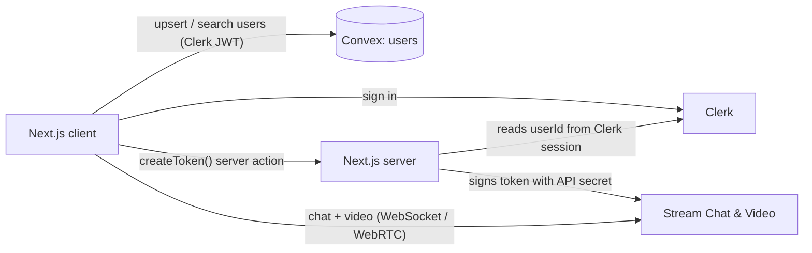

# Beam — Real-time Chat & Video (Telegram-style clone)

A Telegram-style messaging web app with one-to-one chats, group chats and video calls. Users sign in with Clerk, their profiles are synced to a Convex database for user search, and messaging and calls run on Stream.

<!-- TODO: add 2–3 screenshots or a short GIF here, e.g.


-->

<!-- TODO: add the live link once deployed, e.g. **Live demo:** https://your-app.vercel.app -->

## Features

- **Authentication** — sign up / sign in with Clerk; `/dashboard` routes are protected by Clerk middleware.
- **User directory and search** — signed-in users are synced to Convex on login and can be found by name or email (debounced search).
- **One-to-one chats** — reuses an existing conversation between the same two people instead of creating duplicates.
- **Group chats** — select multiple users and optionally name the group.
- **Real-time messaging** — message list, input and threads via Stream Chat React components; channels are sorted by latest message.
- **Leave chat** — remove yourself from a conversation.
- **Video calls** — start a call from any chat (Stream Video), with speaker layout, call controls, screen sharing, reactions, and a copyable invite link while waiting for others.
- **Connection states** — loading, joining, reconnecting and error screens for chat sync and calls.

## Tech stack

| Area | Technology |
|---|---|
| Framework | Next.js 15 (App Router, Turbopack), React 19, TypeScript |
| UI | Tailwind CSS v4, shadcn/ui (Radix primitives), lucide-react |
| Auth | Clerk (`@clerk/nextjs`) |
| Database | Convex (user records and search) |
| Messaging | Stream Chat (`stream-chat`, `stream-chat-react`) |
| Video | Stream Video (`@stream-io/video-react-sdk`) |

## Architecture



How a session starts:

1. Clerk authenticates the user. `middleware.ts` protects everything under `/dashboard`.
2. `UserSyncWrapper` upserts the user's name, email and avatar into Convex. The Convex mutation checks that the caller's Clerk identity matches the record being written.
3. The client calls the `createToken` server action. The server reads the user ID from the Clerk session (not from the request) and signs a Stream token with `STREAM_API_SECRET_KEY`, which never reaches the browser.
4. The client connects to Stream Chat with that token. The sidebar lists channels where the user is a member.
5. Starting a call navigates to `/dashboard/video-call/[channelId]`, which creates or joins a Stream Video call with the same ID.

### Project structure

```
actions/createToken.ts        Server action: issues Stream tokens for the signed-in user
app/page.tsx                  Public landing page
app/(signed-in)/layout.tsx    Auth-only shell: user sync, Stream <Chat>, sidebar
app/(signed-in)/dashboard/    Chat view and video-call route
components/                   Sidebar, new-chat dialog, user search, shadcn/ui components
convex/schema.ts, users.ts    Users table, upsert and search functions
hooks/                        useCreateNewChat, useUserSearch, useDebounce
lib/stream.ts, streamServer.ts  Stream client (browser) and server client
middleware.ts                 Clerk route protection
```

## Getting started

### Prerequisites

- Node.js 18.18 or later and pnpm (a `pnpm-lock.yaml` is committed)
- Free accounts on [Clerk](https://clerk.com), [Convex](https://convex.dev) and [Stream](https://getstream.io)

### 1. Install

```bash
git clone https://github.com/Krigoy/Telegram-2.0-clone.git
cd Telegram-2.0-clone
pnpm install
```

### 2. Configure services

1. **Clerk:** create an application, then under **JWT Templates** create a template using the **Convex** preset (it must be named `convex`). Copy its *Issuer* URL.
2. **Convex:** run `npx convex dev` once and log in. It creates a deployment and writes `CONVEX_DEPLOYMENT` and `NEXT_PUBLIC_CONVEX_URL` to `.env.local`. In the Convex dashboard, add an environment variable `CLERK_JWT_ISSUER_DOMAIN` set to the Clerk issuer URL.
3. **Stream:** create an app and copy its API key and secret.

### 3. Environment variables

```bash
cp .env.example .env.local
```

| Variable | Where it's used |
|---|---|
| `NEXT_PUBLIC_CLERK_PUBLISHABLE_KEY` | Clerk client |
| `CLERK_SECRET_KEY` | Clerk server / middleware |
| `CONVEX_DEPLOYMENT`, `NEXT_PUBLIC_CONVEX_URL` | Convex client (written by `npx convex dev`) |
| `NEXT_PUBLIC_STREAM_API_KEY` | Stream Chat and Video clients |
| `STREAM_API_SECRET_KEY` | Server only — signs Stream tokens |
| `CLERK_JWT_ISSUER_DOMAIN` | Set in the **Convex dashboard**, read by `convex/auth.config.ts` |

### 4. Run

```bash
pnpm dev
```

This starts Next.js and `convex dev` together. Open http://localhost:3000, sign up with two different accounts (e.g. one in a private window) and start a chat between them.

> The `dev` script uses `&` to run both processes, which works in macOS/Linux shells. On Windows, run `npx convex dev` and `npx next dev --turbopack` in two terminals.

## Security notes

- Stream tokens are minted only for the user in the current Clerk session; the API secret stays on the server.
- Convex functions verify the Clerk identity before writing a user record or returning search results.
- Secrets live in `.env.local`, which is git-ignored; `.env.example` contains placeholders only.

## Limitations and next steps

- Not deployed yet — no public demo link.
- User search loads all users and filters in memory; a Convex search index would be needed at scale.
- No automated tests.
- No message encryption beyond what Stream provides in transit.
- Ideas: message search, notifications for new messages, and deployment to Vercel with a production Convex deployment.

## Acknowledgements

<!-- TODO: If this app was built following a tutorial, credit it here (name and link) and list what you changed or added yourself. Reviewers value that honesty. -->
